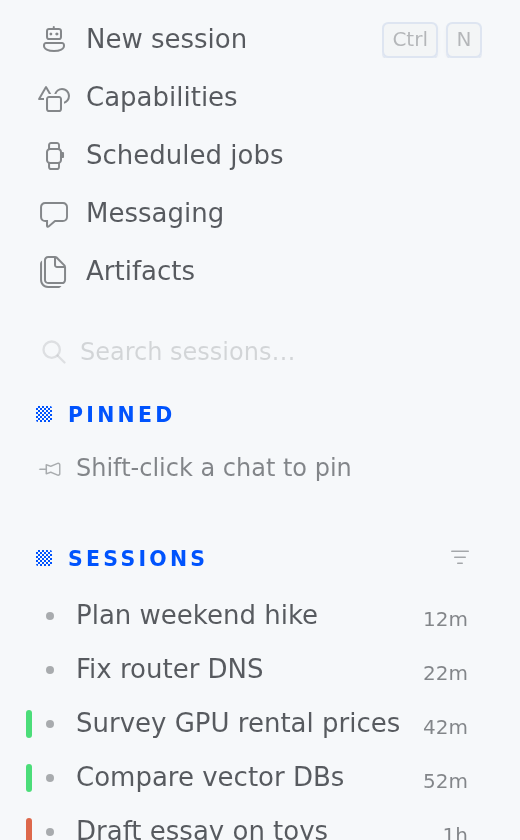
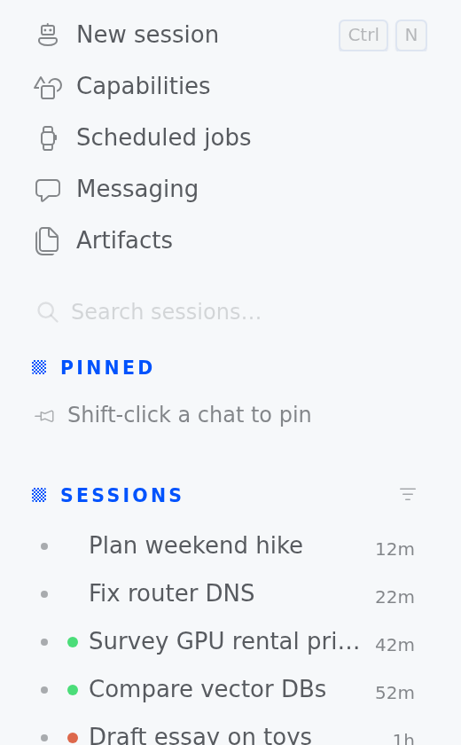
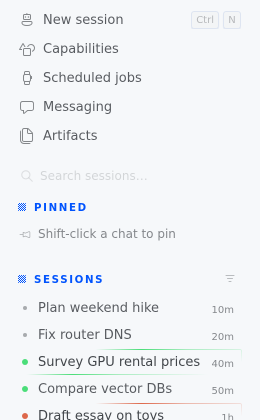

# Sidebar Tidy

A [Hermes Desktop](https://hermes-agent.nousresearch.com/docs) plugin that lets you hide, auto-hide and reorder parts of the sidebar.

It started with a small annoyance: the **Pinned** section shows up even when nothing is pinned. Sidebar Tidy fixes that by default, and also lets you control every other section.

## Features

| Part | Modes |
|---|---|
| **Pinned** | Always · **When not empty** (default) · Hidden |
| **Sessions** | Shown · Hidden |
| **Search sessions** | Shown · **Keyboard only** · Hidden |
| **Cron jobs** | Shown · Hidden |
| **Profile rail** | Shown · Hidden |
| **Messaging channels** | All on/off, plus a switch per platform (Discord, Telegram, iMessage, …) |
| **Nav rows** | Show/hide and reorder New session, Messaging, Artifacts, Scheduled jobs, and rows added by other plugins |
| **Profile marks** | Off · **Edge** (default) · Dot · Tint, plus "Mark default-profile sessions too" |
| **Working dot** | **Accent** (default) · Quiet |
| **Working shine** | **Stock** (default) · Profile |

**Profile marks** color each session row by the profile that owns it, using the same color as that profile's tile in the profile rail. They matter most with *All profiles* turned on, when sessions from several profiles share one list.

- **Edge** draws a short stripe in the row's left margin. Titles don't move.
- **Dot** puts a small dot after the status dot. Every row gets the same space, so titles still line up.
- **Tint** adds nothing: it recolors Desktop's own status dot while a session is idle, so each row keeps one dot. Working, waiting, unread and draft dots keep their usual colors, and so does a session that already has a project or session color.
- Default-profile sessions are left unmarked unless you turn on *Mark default-profile sessions too*; they then get an outline, like the rail's neutral tile.
- **Working sessions.** Desktop marks a running session twice: an accent-colored dot *and* a shine that travels around the row. **Working dot → Quiet** drops the accent so the dot takes the session's profile color (grey for default) and the shine alone says it's busy. **Working shine → Profile** colors that shine in the profile's color (default-profile sessions keep the stock shine). Waiting-for-you (amber) and unread (green) dots are never changed. Both work with profile marks Off.
- To change a profile's color, right-click its square in the profile rail and choose **Color** (or press and hold the square). The picker isn't available once the rail collapses to a dropdown (more than 13 profiles). The settings page shows a legend of the profiles in your list.

   

**Keyboard only** search stays out of sight until you press the *Focus session search* shortcut (⌘⇧F / Ctrl+Shift+F) or there's a query in it.

**Capabilities** can't be hidden. It holds Settings → Plugins, which is where you'd turn this plugin off.

### Extras

- **Focus mode**: ⌘⌥B / Ctrl+Alt+B, rebindable in Keyboard Shortcuts. Leaves only New session, Pinned (if anything is pinned) and Sessions. Your saved settings stay as they were. A `focus` chip in the status bar shows it's on, and clicking it turns focus mode off.
- **Peek**: hold ⌥ Option / Alt with the pointer over the sidebar to see hidden parts, faded and outlined.
- **Command palette**: ⌘K → `Sidebar:` has Customize, Toggle focus mode, Show everything, a profile-marks cycle (Off → Edge → Dot → Tint), and quick toggles for Pinned, search, Cron jobs, messaging and the profile rail.
- **Settings page**: Settings → Plugins → Sidebar Tidy, with a "Show everything" reset and a "Tidy preset" (Pinned when not empty, search keyboard only).

## Install

Desktop plugins load on **the computer running Hermes Desktop**, even when your gateway is remote.

1. In Hermes Desktop, open **Settings → Plugins → Reveal plugins folder**.
2. Put this repo there as a folder named `sidebar-tidy`:

   ```bash
   cd "<plugins folder>"          # usually ~/.hermes/desktop-plugins
   git clone https://github.com/sapochat/hermes-sidebar-tidy sidebar-tidy
   ```

   The result must be `desktop-plugins/sidebar-tidy/plugin.js`.
3. It loads within a few seconds, no restart. If it doesn't, run **Reload desktop plugins** from ⌘K.

To update, run `git pull` in that folder; Desktop hot-reloads it. To remove it, turn it off in **Capabilities → Plugins** or delete the folder. Turning it off puts the sidebar back to stock immediately.

## How it works

The plugin uses the official SDK wherever there is one, and keeps its own DOM work narrow and fail-safe where there isn't.

- **Nav rows** go through the SDK's `sidebarNav.prefs` contribution area. Core renders the hiding and ordering, and unloading the plugin removes the preference.
- **Session sections, search and the profile rail** have no SDK hook yet. The plugin finds them by their stable `data-*` attributes and their (localized) section labels, marks them with `data-sbt-*` attributes, and hides them with one injected stylesheet. A `MutationObserver` scoped to the sidebar keeps the marks current.
- **Fails open**: anything the plugin can't identify is left visible. If a Desktop update changes the sidebar markup, sections reappear rather than vanish.
- **"When not empty" for a collapsed Pinned section** reads Desktop's stored pin list, because a collapsed section renders no rows to count.
- **Profile marks** use the SDK's `sessionRow.leading` slot. That slot passes only a session id, so the plugin reads which profile owns each session from one read-only, all-profiles `host.listPersistedSessions` call. It refreshes the list when a row shows an id it hasn't seen, and leaves rows unmarked if it can't tell. Colors come from the SDK's `profileColor` plus your rail color overrides. **Tint** is the exception to "official hooks only": Desktop's status dot has no plugin hook, so a stylesheet rule recolors the idle dot in any row that carries the plugin's (zero-width) tint slot. If a Desktop update changes that markup, the rule matches nothing and the dot stays grey. **Working dot** and **Working shine** work the same way: a hidden marker in the row slot plus stylesheet rules that match only that row's accent (working/stalled) dot and its shine, regenerated per profile color. Markup changes leave the stock dot and shine.
- **Storage**: settings live in the plugin's own `ctx.storage`. The plugin never writes pins, sessions or core settings.
- **Cleanup**: every listener, timer, observer, mark and the stylesheet are released when the plugin is disabled or reloaded.

### Known limits

- Session-section hiding depends on Desktop's current sidebar markup, so a future Desktop release could stop it working. Nothing gets hidden by mistake when that happens.
- With several **remote** connections, "When not empty" on a *collapsed* Pinned section may not be able to tell which connection's pins apply. In that case it shows the section.
- Profile ownership comes from the newest 500 sessions across profiles. Older rows past that stay unmarked.
- Messaging platforms appear in the settings once the sidebar has shown them at least once.

## Tests

`e2e/run.mjs` is an end-to-end test that drives a real, running Hermes Desktop over the Chrome DevTools Protocol. It checks the rendered sidebar after clicking through the plugin's own settings UI. It writes only this plugin's settings and never pins or edits sessions.

It covers each mode of every section, settings persistence, Pinned auto-hide as rows appear and disappear, per-platform and all-messaging hiding, keyboard-only search, nav hide and reorder, the locked Capabilities row, peek, the focus-mode keybind and status chip, the palette commands, profile marks (each style including Tint's recolored status dot, Quiet working dots and profile-colored shine on simulated working and waiting rows, per-profile color matching the rail, title alignment, the default-profile option, the legend, persistence), "Show everything", and disable/re-enable cleanup.

Run it against an **isolated** Desktop instance, never your daily app. `e2e/isolated.sh` builds one: it seeds a fresh Hermes home from `e2e/fixture_sql.py` (six sessions across `default`, `research` and `writing`, plus one paused cron job), copies in `plugin.js`, and redirects `HOME`, `XDG_*` and the gateway lock dir into the scratch folder. Setting only `HERMES_HOME` is not enough: the dev app would find your host's live gateway and real profiles.

```bash
# in a hermes-agent checkout (Node >= 26)
npm ci --workspace apps/desktop --include-workspace-root
node node_modules/electron/install.js            # if the Electron binary is missing
cd apps/desktop
node scripts/bundle-electron-main.mjs --dev
npx vite --host 127.0.0.1 --port 5194 --strictPort &

# any freshly initialised Hermes state.db works as the schema template
/path/to/hermes-sidebar-tidy/e2e/isolated.sh "$PWD/../.." /path/to/template/state.db /tmp/sbt-run &
sleep 60
# --home lets the new-session test add one chat to the fixture (never a real home)
node /path/to/hermes-sidebar-tidy/e2e/run.mjs --port 9333 --match 5194 --home /tmp/sbt-run/home --out results.json
```

Set `HERMES_DESKTOP_HERMES_ROOT` to a hermes-agent checkout with its Python venv if the Desktop checkout doesn't have one. The script stops any gateway left over from a previous run in the same scratch folder before reseeding it.

The last recorded run is in [`e2e/results.json`](e2e/results.json): **47/47** on Hermes Desktop `main` at `9a76ac8e4f` (2026-10-31), Electron 44.9.3, Linux under Xvfb, first run against a freshly seeded instance. The earlier 1.0.0 run was 26/26 on 0.22.2.

## Compatibility

Built and tested against Hermes Desktop **0.22.2**. It needs `SIDEBAR_NAV_PREFS_AREA` and `ctx.registerSettingsPage` in the plugin SDK. On older builds the settings page is skipped; use the ⌘K commands instead. Profile marks also need `SESSION_ROW_AREAS` and `host.listPersistedSessions`; builds without them load the rest of the plugin and hide the profile-marks setting.

## License

MIT
